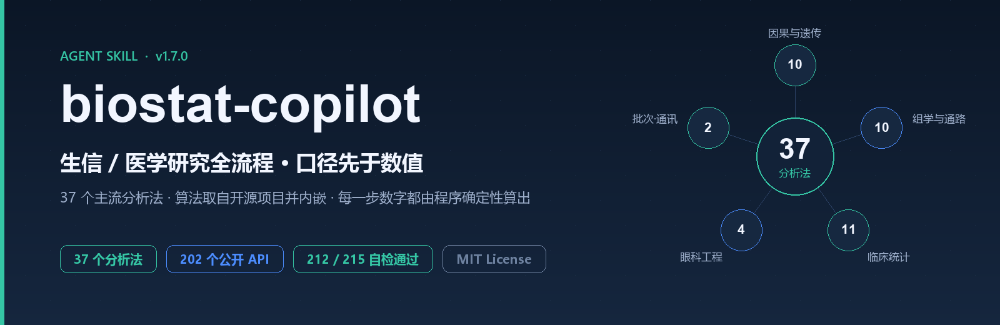

<div align="center">

<picture>
  <source media="(prefers-color-scheme: dark)" srcset="assets/brand-dark.svg">
  
</picture>

**An evidence-first workflow skill for bioinformatics and medical research — 48 analysis methods that AI agents can actually run.**

[](VERSION)
[](LICENSE)
[](#requirements)
[](tests/run_all.py)
[](https://github.com/cndoin/med-biostat-skill/actions/workflows/checks.yml)
[](#install-into-your-ai-agent)

**English** · [简体中文](README.zh-CN.md) · [日本語](README.ja.md)

[Quick start](#quick-start) · [Analysis methods](#analysis-methods) · [Install into your agent](#install-into-your-ai-agent) · [License](#license)

</div>



## What it is

A **cross-agent research skill** for medical and bioinformatics work. Install it into Claude Code, Codex, or WorkBuddy, and when you ask something like *"analyse this GWAS summary statistics"*, *"is this gene causally linked to cataract"*, or *"double-check whether my results are right"*, it loads **automatically** and runs the analysis inside a fixed methodological framework — instead of letting the model improvise code.

The problem it solves is not "can the AI write the code". It is **caliber** (口径) — the definition a number was computed under.

- λGC has two legitimate definitions; mixing them yields two different numbers for the same file.
- How missing values are handled changes every downstream conclusion.
- "Matches the official release" means nothing if it is asserted from "the numbers look close" rather than proven by hashes.

So this skill treats **caliber as a first-class citizen**: a result without a stated caliber is treated as invalid; anything computable is computed by a script; anything verifiable is verified by a hash.

## Three principles

| # | Principle | Meaning |
|---|---|---|
| 1 | **Caliber before numbers** | One name under two calibers is two different quantities. A missing caliber is an error, not a default. |
| 2 | **Consistency beats "looks right"** | "Matches the official release" must be proven by hashes and byte counts, never inferred from "close enough". |
| 3 | **Confounding is the main battlefield** | Failures rarely sit in the algorithm. Bias auditing is its own layer, with all twelve items checked one by one. |

## Analysis methods

| Group | Count | Covers |
|---|---|---|
| Causal & genetic | 10 | Mendelian randomization (7 estimators + 7 sensitivity checks), drug-target cis-MR chain, colocalization, fine-mapping (SuSiE), PRS, GWAS QC, independent loci, observational causal inference (PSM / IPTW / AIPW), mediation, DiD |
| Omics & pathways | 10 | Differential expression, WGCNA, ORA, GSEA, GSVA / ssGSEA, single-cell pipeline, immune infiltration, pseudotime, spatial transcriptomics, mutational signatures |
| Clinical stats & modelling | 11 | Survival analysis, competing risks (CIF), prediction models (calibration + DCA), C-index / NRI / IDI, regularized regression (LASSO / Cox-LASSO), meta-analysis, publication bias, MICE imputation, multiple-testing correction, mixed effects, power & sample size |
| Data engineering & ophthalmology | 4 | Data cleaning & variable selection, IOL refractive calculation, visual acuity / refractive outcomes, lens gene-set enrichment |
| Preprocessing & cell interaction | 2 | ComBat batch correction, cell–cell communication (ligand–receptor) |
| Extended methods | 4 | Gene–environment interaction (G×E), EWAS methylation, bidirectional / mediation MR, cell-type annotation |

Entry points, required calibers and common pitfalls for each method are in [`SKILL.md`](SKILL.md).

## Quick start

### Requirements

| Item | Requirement |
|---|---|
| Python | **3.9+** (Tier 0 is standard library only) |
| OS | Windows / macOS / Linux |
| Optional stack | `numpy` + `pandas` + `scipy` (Tier 1 only) |

```bash
git clone https://github.com/cndoin/med-biostat-skill.git
cd med-biostat-skill
```

### 1. Run the self-check (no third-party dependencies)

Tier 0 is pure standard library, so it runs straight after cloning:

```bash
python tests/run_all.py            # full self-check
python scripts/capabilities.py     # which tier is ready on this machine
python scripts/doctor.py           # environment and dependency report
```

### 2. Install Tier 1 (optional, needed for full capability)

```bash
python -m venv .venv
source .venv/bin/activate          # Windows: .venv\Scripts\activate
pip install -r vendor/requirements.txt
```

`scripts/capabilities.py` will then report Tier 1 as ready. **Missing dependencies never produce false failures** — cases that cannot run are reported as SKIP, not FAIL.

### 3. Check auto-triggering

```bash
python scripts/trigger_check.py
```

It runs 29 positive and 4 negative prompts to verify which phrasings load the skill and which must not.

## Install into your AI agent

The skill follows **one authoritative `SKILL.md` plus a generator that writes each agent's entry point**. No hand-written duplicates — that is how entry points drift. Everything is produced by `scripts/install_adapters.py`.

```bash
# Global skill directories (read automatically by each agent)
python scripts/install_adapters.py --target claude       # → ~/.claude/skills/biostat-copilot/
python scripts/install_adapters.py --target codex        # → ~/.codex/skills/biostat-copilot/
python scripts/install_adapters.py --target workbuddy    # → ~/.workbuddy/skills/biostat-copilot/

# Project-level rule files
python scripts/install_adapters.py --target cursor  --project /path/to/proj   # .cursor/rules/
python scripts/install_adapters.py --target cline   --project /path/to/proj   # .clinerules/
python scripts/install_adapters.py --target gemini  --project /path/to/proj   # GEMINI.md
python scripts/install_adapters.py --target copilot --project /path/to/proj   # .github/copilot-instructions.md
python scripts/install_adapters.py --target agents  --project /path/to/proj   # AGENTS.md

# Everything at once
python scripts/install_adapters.py --target all --project /path/to/proj
```

| Agent / tool | Entry point | Target |
|---|---|---|
| Claude Code | `SKILL.md` | `claude` |
| Codex | `SKILL.md` | `codex` |
| WorkBuddy | `SKILL.md` | `workbuddy` |
| Cursor | `.cursor/rules/<name>.mdc` | `cursor` |
| Cline | `.clinerules/<name>.md` | `cline` |
| Gemini CLI | `GEMINI.md` | `gemini` |
| GitHub Copilot | `.github/copilot-instructions.md` | `copilot` |
| Generic (AGENTS.md family) | `AGENTS.md` | `agents` |

**How to confirm it loaded:** ask your agent *"run a survival analysis and a prediction model"*. If it starts by fixing calibers, running scripts, and returning results with their calibers attached, the skill is active. You can also run `python scripts/trigger_check.py` locally to check trigger coverage.

> The installer syncs in place (idempotent, safe to re-run) and will not destroy other content in the target directory.

## Three tiers

| Tier | Location | Dependencies | Capability |
|---|---|---|---|
| **Tier 0** | `scripts/` | Python standard library | fetch / verify / QC / locus counting / credible-set filtering / region annotation / confounder audit / per-variant cross-checking / report gating |
| **Tier 1** | `vendor/` + `lib/` | numpy + pandas + scipy | most of the 37 methods; pure-SVG charts; function registry; reporting-standard checklists |
| **Native** | `vendor/native/` | none (single executable) | streaming QC over million-row GWAS summary statistics (3M rows in 551 ms, ≈11× Python) |

Tier 1's 22 modules are probed **one by one**: a missing dependency in one module never marks the others unavailable.

## Where the algorithms come from

**Core rule: do not write the algorithms yourself.** Every statistical and optical routine is taken from an open-source project, trimmed to its core, re-homed onto lighter dependencies, and annotated in its file header with source, license and known deviations.

| Upstream project | License | Provides | Bundled at |
|---|---|---|---|
| [pymr](https://github.com/maxghenis/pymr) | Unlicense | full Mendelian randomization suite | `vendor/_mr/` |
| [GSEApy](https://github.com/zqfang/GSEApy) | BSD-3-Clause | enrichment statistics, GSEA core, ssGSEA | `vendor/_enrich/` |
| [scanpy](https://github.com/scverse/scanpy) | BSD-3-Clause | single-cell pipeline, ComBat | `vendor/_sc/` `vendor/_batch/` |
| [PyWGCNA](https://github.com/mortazavilab/PyWGCNA) | MIT | WGCNA co-expression networks | `vendor/_wgcna/` |
| [CellPhoneDB](https://github.com/ventolab/CellphoneDB) | MIT | cell–cell communication | `vendor/_cellcomm/` |
| [pearldgs_toolbox](https://github.com/gdebel/pearldgs_toolbox) | MIT | IOL optics | `vendor/_ophtha/` |
| rsomics-vcf | MIT OR Apache-2.0 | native GWAS acceleration (source-level fork) | `vendor/native/` |

**GPL projects are never bundled** — they would be viral. They are fetched on demand and called as external tools instead:

```bash
python tools/fetch_tools.py --fetch lifelines
```

Full provenance, hashes and de-duplication decisions are in [`vendor/ATTRIBUTION.md`](vendor/ATTRIBUTION.md); third-party license texts ship alongside the code in each `vendor/_*/LICENSE`.

## What it is not

- **Not a template generator.** The "seven-piece" GEO-chip pipeline (DEG + WGCNA + LASSO + immune infiltration) and the ferroptosis / cuproptosis / m6A template stacks are rejected at the entrance.
- **Not a number generator.** Every number comes from a re-runnable script, or from a citable official release with its caliber stated.
- **Not a direction salesperson.** When a direction is already covered, the skill's duty is to **stop**, not to rephrase and keep packaging it.

## Repository layout

```
med-biostat-skill/
├── SKILL.md              entry point (routing · red lines · gates · method table)
├── VERSION
├── README.md             English (this file)
├── README.zh-CN.md       简体中文
├── README.ja.md          日本語
├── references/           knowledge layer (loaded on demand, zero standing cost)
├── scripts/              Tier 0 (standard library) + cross-agent installer
├── lib/                  Tier 1 extensions (22 modules)
├── vendor/               Tier 1 bundled layer (provenance in ATTRIBUTION.md)
├── pipeline/             deterministic pipelines (the AI does not touch the numbers)
├── tools/                vendor_sync · fetch_tools · wrapper_core · native_accel
├── assets/               brand, banner and templates
├── adapters/             per-agent entry templates
└── tests/                self-check layer
```

## Self-check and quality gates

```bash
python tests/run_all.py            # 216 / 219 pass (3 skipped: lifelines not installed)
python tests/run_all.py --json     # machine readable
python scripts/capabilities.py     # two-tier capability report
python scripts/trigger_check.py    # auto-trigger coverage (29 positive / 4 negative)
```

**A gate only counts if it has been shown to fail.** `tests/test_guards_negative.py` deliberately builds degenerate detectors (constant output, semantic reversal) and fake data to prove the gates turn red. A "0 failures" that comes from a gate being decorative is worse than having no gate at all.

## License

**MIT** — see [`LICENSE`](LICENSE).

Bundled third-party components keep their original licenses (Unlicense / BSD-3-Clause / MIT): full texts ship in each `vendor/_*/LICENSE`, the summary is in [`THIRD_PARTY_NOTICES.md`](THIRD_PARTY_NOTICES.md), and complete provenance is in [`vendor/ATTRIBUTION.md`](vendor/ATTRIBUTION.md).
